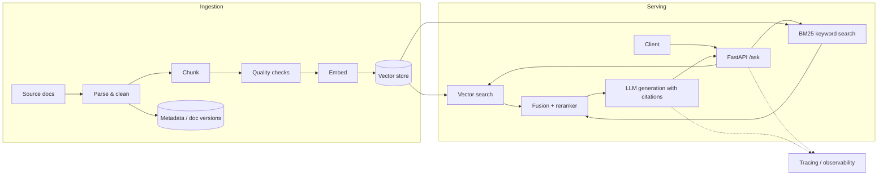

# Project 1: Production RAG Service with Evaluation

> Repo: `github.com/olehkuzin/rag-service` (rename as you like)

## 1. Idea

A retrieval-augmented generation (RAG) service that answers questions over a realistic, public document set and returns **cited answers**. The focus is not "chat with PDF" but on three things most demos skip:

1. **Measured quality**: an evaluation set and a comparison of retrieval and prompt variants.
2. **Production hygiene**: tests, Docker, CI, deployment, tracing.
3. **A reliable data layer**: incremental ingestion, versioning, and quality checks, which is where a data engineering background is an advantage.

### Suggested corpus
Pick one public, non-trivial corpus (500+ pages) and state its size in the README. Options:
- Official documentation of an open-source tool (e.g. dbt, Airflow, Postgres docs)
- Public regulations or standards (e.g. GDPR text plus guidance)
- A technical manual or a set of RFCs

### Example question types the eval set should cover
- Direct fact lookup
- Multi-chunk synthesis (answer spans 2+ sections)
- Questions with no answer in the corpus (the system should say "I don't know")
- Ambiguous or paraphrased questions

## 2. Architecture



### Components

| Component | Responsibility |
|---|---|
| **Ingestion pipeline** | Parse, clean, chunk, embed, upsert. Incremental: only re-process documents whose content hash changed. |
| **Data quality checks** | Drop empty/duplicate chunks, enforce min/max chunk size, validate metadata (source, section, version). |
| **Vector store** | Stores embeddings plus metadata. Supports filtering by document/version. |
| **Hybrid retrieval** | Vector search + BM25, merged with reciprocal rank fusion. |
| **Reranker** | Cross-encoder or hosted rerank API over the top-N candidates. |
| **Generator** | LLM prompt with retrieved context, structured output (answer + citations + confidence / "not found"). |
| **API layer** | FastAPI, request/response validated with Pydantic. |
| **Observability** | Trace each request: query, retrieved chunks, scores, prompt, latency, token cost. |
| **Evaluation harness** | Runs a labeled question set against pipeline variants and outputs a metrics report. |

### API sketch

```
POST /ask
{ "question": "string", "top_k": 5 }

200 OK
{
  "answer": "string",
  "citations": [{ "doc": "string", "section": "string", "chunk_id": "string", "score": 0.0 }],
  "found": true,
  "latency_ms": 0,
  "usage": { "input_tokens": 0, "output_tokens": 0 }
}

POST /ingest        # trigger incremental ingestion
GET  /health
```

## 3. Stack

| Layer | Choice | Notes |
|---|---|---|
| Language | Python 3.12 | |
| API | FastAPI + Pydantic | Async endpoints |
| Vector store | Qdrant (or Postgres + pgvector) | pgvector is simpler to deploy on AWS RDS; Qdrant has native hybrid search |
| Embeddings | A hosted embedding model (e.g. Voyage or OpenAI) | Keep the provider behind an interface |
| LLM | Anthropic Claude via the official SDK | Provider abstraction so you can compare models |
| Reranker | Hosted rerank API or `bge-reranker` | Optional, but measure its effect |
| Keyword search | `rank_bm25` or Postgres full-text search | |
| Observability | Langfuse (or OpenTelemetry) | Trace retrieval and generation |
| Evaluation | Custom harness + Ragas or DeepEval | LLM-as-judge for faithfulness, plus retrieval metrics |
| Testing | pytest, pytest-asyncio, httpx | Mock the LLM in unit tests |
| Containers | Docker, docker-compose for local dev | |
| CI | GitHub Actions | Lint, test, build image on every commit |
| Deployment | AWS ECS Fargate (or App Runner) + ECR | Secrets in AWS Secrets Manager |
| Tooling | uv or Poetry, ruff, mypy, pre-commit | |

## 4. Evaluation plan

**Dataset:** 100-150 labeled questions: question, reference answer, and the source chunk(s) that contain the answer. Include ~10-15% unanswerable questions.

**Metrics**
- Retrieval: hit rate / recall@k, MRR
- Generation: faithfulness (is the answer supported by the context), answer correctness, citation accuracy
- Abstention: correct "not found" rate on unanswerable questions
- Operational: p50/p95 latency, cost per query

**Experiments to run and report**

| Variant | What changes |
|---|---|
| Baseline | Fixed-size chunks, vector search only |
| + Better chunking | Structure-aware chunking (by headings), overlap tuned |
| + Hybrid | Vector + BM25 with rank fusion |
| + Reranker | Cross-encoder over top 20 |
| Prompt A vs B | Basic prompt vs. strict "cite or abstain" prompt |

Put the results table in the README. The resume bullet writes itself from it, for example: "Improved answer faithfulness from X% to Y% on a Z-question eval set by adding hybrid retrieval and reranking."

## 5. Repository layout

```
rag-service/
├── app/
│   ├── api/            # FastAPI routes, schemas
│   ├── retrieval/      # vector, bm25, fusion, rerank
│   ├── generation/     # prompts, LLM client, output parsing
│   ├── ingestion/      # parsers, chunkers, quality checks, indexer
│   └── observability/  # tracing setup
├── eval/
│   ├── dataset.jsonl
│   ├── run_eval.py
│   └── reports/
├── tests/
├── infra/              # Terraform or CDK for AWS (optional but a plus)
├── Dockerfile
├── docker-compose.yml
├── .github/workflows/ci.yml
└── README.md
```

## 6. Milestones

1. **Baseline**: ingest corpus, naive retrieval, `/ask` endpoint working locally.
2. **Eval set + harness**: build the dataset and record baseline metrics before improving anything.
3. **Improve retrieval**: chunking, hybrid search, reranker; log each experiment.
4. **Production hygiene**: tests, Dockerfile, CI pipeline, tracing.
5. **Deploy** to AWS and add a live demo link or a short recorded demo.
6. **Polish README**: architecture diagram, results table, how to run, limitations.

## 7. README must-haves
- One-paragraph problem statement and corpus description (with size)
- Architecture diagram
- Results table from the evaluation
- "Limitations and next steps" section
- One-command local run (`docker compose up`)

## 8. Stretch goals (only if time allows)
- Query rewriting / decomposition for multi-hop questions
- Semantic caching to reduce cost
- Scheduled re-ingestion with change detection
- A small MCP server exposing `search_docs` so other agents can use the corpus
